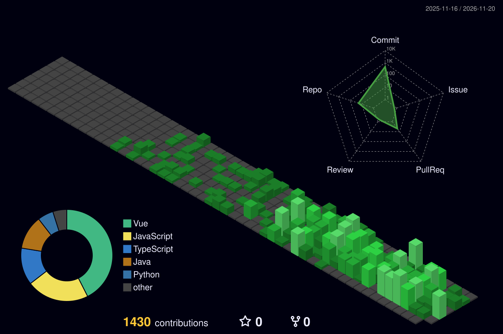

<div align="center">

<!-- ░░ BOOT SEQUENCE ░░ -->


<br/><br/>


</div>

<br/>

```text
┌──[ MANIFEST ]─────────────────────────────────────────────────────────────────┐
│                                                                               │
│  > Myrias: gerenciador de contas do Mercado Livre, rodando em producao        │
│    Java 21 · Spring Boot 3 · Vue 3 · PostgreSQL · Redis · Docker              │
│    OAuth com PKCE, tokens cifrados com AES-GCM, fila distribuida no Redis     │
│    agente de IA que sugere a mudanca e um humano aprova antes de subir        │
│  > Dez/2026: entrando como estagiario de DevSecOps na Netglobe Cyber          │
│    pegando Go e AppSec com codigo de verdade                                  │
│  > Quant nas horas vagas: walk-forward, Monte Carlo, custo real no backtest   │
│                                                                               │
└───────────────────────────────────────────────────────────────────────────────┘
```

## `$ ./skillscan --sweep`

<div align="center">

</div>

## `$ cat stack.yml`

```yaml
# o que eu uso toda semana
backend:     [Java 21, Spring Boot 3, JPA/Hibernate, Flyway, Maven, JUnit]
dados:       [PostgreSQL, Redis, Supabase]
python:      [FastAPI, Flask, Pandas, Scrapling]
front:       [Vue 3, Vite, Angular, React, TypeScript]
integracoes: [Node + Baileys (WhatsApp), API do Mercado Livre, OAuth2]
ia:          [LLMs via OpenRouter (DeepSeek), agentes com aprovacao humana]
infra:       [Docker, Linux em VPS, AWS EC2, Nginx, GitHub Actions]
seguranca:   [Semgrep, Gitleaks, Dependabot, OWASP ZAP passivo no CI]

# carregando...
aprendendo:
  - Go       # stack do time na Netglobe
  - AppSec   # PortSwigger Academy, OWASP Top 10 e API Top 10
```

## `$ ls ~/projects`

| projeto | o que faz | stack |
|---|---|---|
| Myrias <sub>(repo privado)</sub> | Gerencia as contas da empresa no Mercado Livre: anúncios em massa, analytics, controle de acesso por papel e um agente de IA que só publica depois que alguém aprova. A equipe de operações usa todo dia. | Java, Spring Boot, Vue 3, PostgreSQL, Redis |
| [AgentHUB](https://github.com/henriqueVMdev/AgentHUB) | Painel local pra criar e rodar agentes de IA, com streaming via SSE e ferramentas de HTTP, arquivos, código e navegador | Java 21, Spring Boot 3, React, PostgreSQL |
| [Basanos](https://github.com/henriqueVMdev/Basanos) | Laboratório de pesquisa quant. Serve pra descobrir se uma estratégia aguenta validação honesta (walk-forward, Monte Carlo, permutation test) ou se era sorte | Python, Flask, Vue 3 |
| [erp-connector-lib](https://github.com/henriqueVMdev/MultiErp) | Lib Java sem framework que lê pedidos de ERPs diferentes e devolve num modelo só. Ainda no começo | Java |
| [OmniSeg](https://github.com/henriqueVMdev/OmniSeg) | Controle de EPIs feito pro SENAI | Vue 3, Supabase |

## `$ render --contrib --mode 3d`

<div align="center">

</div>

## `$ ./quant --ticker HENRIQUEVMDEV/CMT`

<div align="center">



<sub><code>cada candle = 1 semana de commits · verde = mais que a semana anterior · gerado por Action própria</code></sub>

</div>

## `$ ssh henrique@anywhere`

<div align="center">

[](https://github.com/henriqueVMdev)
[](https://www.linkedin.com/in/henrique-de-paula-valim-melo)

<sub><code>connection closed by remote host. █</code></sub>

</div>
